<p align="center"></p>

English (C edition) has been in production since about the fifth century. It has no type checker, so "he don't" ships. Its pronouns are raw pointers that can dangle or point at two things at once. Its plurals and past tenses are a hand-maintained table of legacy special cases that every user has to memorise. This repository is the rewrite, and it comes in two parts.

The **`english`** crate is English (Rust edition). You write sentences as Rust tokens, and grammar is enforced by the type system: subject-verb agreement is a trait bound, case is a trait, determiners know which numbers and sounds they may precede, and a pronoun is a borrow of its antecedent, so the borrow checker rejects a dangling "it".

**`englishc`** is the migration tool for the fifteen centuries of legacy English already out there. It reads ordinary prose and reports what the new edition would reject, in rustc's diagnostic format, with `--fix` for the cases where the right answer is unambiguous.

## englishc

```console
$ cargo run -p englishc -- examples/essay.txt
   Compiling examples/essay.txt (english 2026)
...
error[E0001]: mismatched verb form
 --> examples/essay.txt:3:70
  |
3 | Irregardless of the weather, me and my brother goed to the beach. He are
  |                                                                   -- ^^^ expected `is`, found `are`
  |                                                                   |
  |                                                                   `He` is third-person singular
  |
  = note: in English (Rust edition) this is a compile error: the trait bound `He: TakesAre` is not satisfied
help: use `is`
  |
3 - Irregardless of the weather, me and my brother goed to the beach. He are
3 + Irregardless of the weather, me and my brother goed to the beach. He is
  |
...
error: could not compile `examples/essay.txt` due to 11 previous errors; 5 warnings emitted (run `englishc --fix examples/essay.txt` to apply 15 suggestions)
```

`englishc --fix` applies every machine-applicable suggestion, as `cargo fix` does, and repeats until nothing changes. On the sample essay it produces correct prose and leaves one warning, an ambiguous "it", because only the author knows whether they meant the dog or the ball.

Other flags work the way rustc's do. `englishc --explain E0005` prints the long explanation of an error code, `englishc -W help` lists every lint, `-A lint` and `-D lint` allow or deny one, `--error-format short` prints one line per diagnostic, and a file name of `-` (or none) reads standard input. Inside a document, a line reading `#![allow(double_negative)]` allows a lint for the whole file, and `#[allow(E0002)]` allows it for the next line only, which is how you ship "I can't get no satisfaction" on purpose.

| code    | lint                       | catches                                               |
|---------|----------------------------|-------------------------------------------------------|
| E0001   | `subject_verb_agreement`   | he are, they was, she don't, he always go             |
| E0002   | `indefinite_article`       | a apple, an unicorn, a hour, a MBA                    |
| E0003   | `of_for_have`              | could of, should of                                   |
| E0004   | `regularized_verb`         | goed, runned, bringed                                 |
| E0005   | `wrong_verb_form`          | had went, have ate, I seen it                         |
| E0006   | `regularized_plural`       | childs, mouses, criterions, childrens                 |
| E0007   | `its_confusion`            | its a trap, it's own                                  |
| E0008   | `your_confusion`           | your welcome, your a genius                           |
| E0009   | `there_confusion`          | their is, there going, their going to                 |
| E0010   | `then_for_than`            | bigger then, rather then                              |
| E0011   | `unknown_word`             | irregardless, alot, dont                              |
| E0012   | `lowercase_i`              | i think                                               |
| E0013   | `objective_case_subject`   | me and my brother went (fix: my brother and I went)   |
| warning | `ambiguous_pronoun`        | the dog chased the ball until it stopped              |
| warning | `double_negative`          | I don't have no money                                 |
| warning | `repeated_word`            | the the                                               |
| warning | `absolute_adjective`       | very unique (`unique` is a `bool`, not `PartialOrd`)  |
| warning | `unused_literally`         | literally (prefix with `_` if intentional)            |
| warning | `non_capitalized_sentences`| a sentence that starts in lower case                  |

The lints are deliberately conservative. Each rule looks at a word and its neighbours and fires only where the neighbour rules out the correct reading, so "its a" is flagged and "its tail" is not. Mistakes in irregular forms are predicted rather than listed: for every irregular verb the lint works out what a learner's `-ed` would produce, for every irregular noun what `-s` would produce, and it flags exactly those spellings, minus the handful that are real words ("seed", "winded", "putted").

To keep that honest, the compiler is run over the prose of *The Rust Programming Language*, about 150,000 words that a team of editors has already been over. It reports no errors and 17 warnings. A dozen of those are ambiguous pronouns, several of them genuinely ambiguous ("The runtime will pause the future until it is ready"), and one is a true positive: the book calls ownership "Rust's most unique feature".

## The english crate

```rust
use english::english;

let text = english!(The dog barks. I 'm happy! These mice are small. She doesn 't care.);
assert_eq!(text.to_string(), "The dog barks. I'm happy! These mice are small. She doesn't care.");
```

A sentence that type-checks is rendered back into ordinary text. One that doesn't is a compile error, with a message that says why:

```console
error[E0277]: subject-verb disagreement: `He` needs the -s form of this verb
   --> src/main.rs:7:13
    |
  7 |     let _ = english!(He don 't care);
    |             ^^^^^^^^^^^^^^^^^^^^^^^^
    |             |
    |             third-person singular subjects take -s
    |             required by a bound introduced by this call
    |
    = help: the trait `TakesBase` is not implemented for `He`
    = note: he runs, she does, it has, the dog barks
```

The same mechanism rejects `english!(I is happy)` ("`I` cannot take `is`"), `english!(Me am happy)` ("`Me` cannot be the subject of a sentence"), `english!(A dogs barks)` ("`A` cannot come before a plural noun") and `english!(A apple is red)` ("`A` cannot come before a vowel sound; write `An`"). Each of these is a `compile_fail` doctest, so the claims in this paragraph are checked by `cargo test`.

Contractions are written with a space, as in `don 't`, because since Rust 2021 `don't` is a reserved prefix and rustc will tell you to insert one. Inside the macro, `'t`, `'s`, `'re`, `'m`, `'ve`, `'ll` and `'d` are lifetimes that attach to the word before them when the sentence is rendered.

### Pronouns are borrows

A `Pronoun<'a, P>` holds a shared borrow of the noun it stands for. It cannot outlive that noun, and the noun cannot be moved out of the story while the pronoun is in use:

```console
error[E0505]: cannot move out of `dog` because it is borrowed
 --> src/main.rs:6:10
  |
4 |     let dog = Noun::new("dog").the();
  |         --- binding `dog` declared here
5 |     let it = dog.pronoun(); // `it` borrows the dog
  |              --- borrow of `dog` occurs here
6 |     drop(dog); // the dog leaves the story
  |          ^^^ move out of `dog` occurs here
7 |     println!("{}", english!(it barks));
  |                    ------------------ borrow later used here
  |
help: consider cloning the value if the performance cost is acceptable
  |
5 |     let it = dog.clone().pronoun(); // `it` borrows the dog
  |                 ++++++++
```

An ambiguous pronoun cannot be written at all, because a pronoun borrows exactly one noun. A `Person` has their pronouns in their type, and since a name does not tell you someone's pronouns, `Person::new("Ada")` defaults to `They` until you call `.pronouns(She)` or similar.

### Inflection is computed, never written

Outside the macro you write dictionary forms and the crate inflects them, so overregularised forms are unrepresentable:

```rust
use english::prelude::*;

assert_eq!(She.verb("go").then("home").to_string(), "She goes home.");
assert_eq!(They.past("go").then("home").to_string(), "They went home.");
assert_eq!(It.perfect("begin").to_string(), "It has begun.");
assert_eq!(Noun::new("mouse").plural().the().to_string(), "the mice");
assert_eq!(Noun::new("hour").a().to_string(), "an hour");
```

### How the macro works

`english!` splits its input into sentences at `.`, `!` and `?`. In each one it finds the subject, which is a pronoun, a demonstrative, a determiner followed by one noun, or a variable holding a `Noun`, `Person` or `Pronoun`. The verb's spelling goes to a `const fn` that classifies it as a base form, an `-s` form, `am`, `is`, `are`, `was`, `were`, or an unmarked past or modal. That class becomes a type through a const generic, and `Verb::<BaseForm>::agrees_with` and its siblings each require a different `Takes*` bound of the subject. The noun after a determiner is typed the same way, with `const fn is_plural` and `const fn wants_an` choosing `Noun<Singular>` or `Noun<Plural>` and `Sound<true>` or `Sound<false>`. Every trait carries a `#[diagnostic::on_unimplemented]` message, so a failed bound reads like a grammar note rather than a trait-solver dump. All of this runs on stable Rust.

The tables behind it live in `english::lexicon`: 178 irregular verbs, 68 irregular nouns, and the rules for silent h, "y"-sound vowels, initialisms and numbers that decide between `a` and `an`. `englishc` uses the same tables, which is why the compiler and the crate agree.

The macro understands a subset of English on purpose. Each sentence is one subject, one finite verb and anything at all after it; everything after the verb is passed through unchecked, which is also how English (C edition) handles it.

## Playground

`playground/` holds a single-page playground that runs `englishc` in the browser. `python3 -I playground/build.py` compiles the compiler to `wasm32-unknown-unknown` (it exposes a small C ABI, so no bindgen is needed), compiles each program in `playground/examples/` with rustc and records its real output, and writes the result to `playground/dist/`.

## Building and testing

```console
cargo test                     # unit tests, doctests, and the compile_fail examples
cargo run -p englishc -- -W help
python3 -I playground/build.py # needs the wasm32-unknown-unknown target
```

The workspace has no dependencies beyond the standard library.
